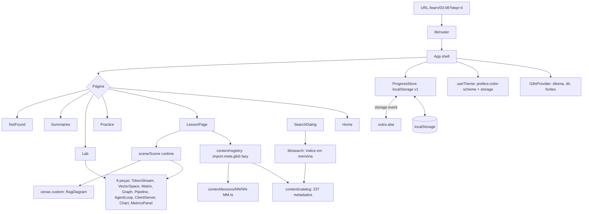

# Learning Platform Design

**Spec**: `.specs/features/learning-platform/spec.md`
**Context**: `.specs/features/learning-platform/context.md`
**Visual design**: `design/tokens-to-agents.figcraft` (PNGs em `design/previews/`, tokens em `design/tokens.css`)
**Status**: Approved (2026-11-18)

---

## Abordagem escolhida

**Evoluir a base que já está na `master` (PR #1).** A stack e o shell continuam. O que muda: conteúdo, motor de cenas, rotas, progresso, i18n e tokens visuais.

| Abordagem | Por que não |
| --- | --- |
| Migrar para Astro + MDX | Melhora SEO e escrita de texto, mas reescreve o shell e complica a navegação por passos (estado da cena entre passos, atalhos, URL do passo). O público chega pela trilha, não por busca orgânica de aula isolada. |
| Reescrever do zero | Descarta shell, hooks e ~20 arquivos de teste que já cobrem atalhos, navegação, busca e o diagrama RAG. |

Decisões de projeto que este design respeita: AD-001 a AD-006 em `.specs/STATE.md`.

---

## Architecture Overview

SPA estática (Vite) com roteamento por History API. Todo o conteúdo é TypeScript tipado e carregado sob demanda por módulo. O estado do aluno fica num store de progresso versionado em `localStorage`.



**Fluxo de uma aula:**
1. O router resolve `/learn/:lessonId` e `?step=n`.
2. `LessonPage` pede ao registry o arquivo da aula, com carregamento lazy por módulo.
3. O passo atual é `clamp(step, 1, N)`. Se `step` for inválido, a página faz `replaceState` para o passo 1.
4. `Scene` recebe o `SceneSpec` do passo e anima a partir do estado anterior.
5. Ao chegar ao último passo, `ProgressStore.completeLesson(id)`.

---

## Code Reuse Analysis

### Existing Components to Leverage

| Componente | Local | Como usar |
| --- | --- | --- |
| Shell (header, sidebar, painel, workspace) | `src/components/layout/*` | Manter a estrutura. Trocar textos por `t()`, ligar ao router e ajustar ao visual do FigCraft. |
| Árvore do curso | `src/components/course/ModuleTreeItem.tsx`, `LessonTreeItem.tsx` | Manter. Passa a ler o catálogo e o `ProgressStore`, e a cor vem de `module/NN`. |
| Navegação por passos | `src/hooks/useLessonNavigation.ts` | Manter `clamp`, `next`/`previous`/`goTo`/`restart`/`togglePlay`. Acrescentar sincronização com `?step` e parar de dar autoplay ao abrir. |
| Atalhos | `src/hooks/useAppShortcuts.ts` | Manter. Acrescentar `R` (repetir) e reaproveitar `isTypingTarget` (LES-01.9 já coberto). |
| Busca | `src/lib/search.ts`, `SearchDialog.tsx` | Manter a normalização sem acento. Ampliar o índice (conceitos e glossário), limite 10 e mensagem de vazio. |
| Utilitários | `src/lib/utils.ts` (`cn`, `normalizeText`, `prefersReducedMotion`) | Reusar como estão. |
| Diagrama RAG | `src/components/diagrams/RagDiagram.tsx` + `ragDiagramLayout.ts` | Vira cena custom (`scene: { kind: "custom", id: "rag-flow" }`). A geometria serve de referência para a peça `Pipeline`. |
| UI base | `src/components/ui/Button.tsx`, `Badge.tsx`, `Kbd.tsx` | Restilizar com os tokens. Acrescentar as variantes do design system (primary, secondary, small, disabled, tab). |
| Testes | `src/test/setup.ts`, `reducedMotion.ts` | Reusar o setup e o mock de `matchMedia`. |

### Integration Points

| Sistema | Integração |
| --- | --- |
| `docs/ai-engineering-roadmap.md` | Fonte da verdade dos 237 títulos. Um teste lê o markdown e compara com `content/catalog.ts` (CNT-01.1). |
| `design/tokens.css` (FigCraft) | Copiado para `src/styles/tokens.css` e mapeado em `@theme` do Tailwind v4. |
| Vercel | `vercel.json` com rewrite SPA. `@vercel/analytics` é injetado no `main.tsx`. |

---

## Components

### Router

- **Purpose**: converter entre URL e rota tipada, sem dependência externa.
- **Location**: `src/lib/router.ts`, `src/hooks/useRoute.ts`
- **Interfaces**:
  - `type Route = { name: "home" } | { name: "lesson"; lessonId: string; step: number | null } | { name: "practice"; moduleId?: string } | { name: "lab"; playgroundId?: string; projectId?: string } | { name: "summaries"; moduleId?: string } | { name: "not-found" }`
  - `parseRoute(pathname: string, search: string): Route`
  - `buildPath(route: Route): string`
  - `useRoute(): { route: Route; navigate(route: Route, opts?: { replace?: boolean }): void }`, que escuta `popstate`.
- **Dependencies**: History API.
- **Reuses**: substitui `useState(activeSection)` e `selectedLessonId` em `App.tsx`.

### Content model and registry

- **Purpose**: tipar, carregar e validar as 237 aulas, os quizzes, os resumos, os playgrounds e os projetos.
- **Location**: `src/types/content.ts`, `src/content/catalog.ts`, `src/content/registry.ts`, `src/content/lessons/NN/NN-MM-slug.ts`, `src/content/quizzes/NN.ts`, `src/content/summaries/NN.ts`, `src/content/projects/0N.ts`, `src/content/glossary.ts`
- **Interfaces**:
  - `catalog: ModuleMeta[]` (número, título, cor e `LessonMeta[]` com id `NN-MM`, número, título do roadmap, duração e nível)
  - `loadLesson(id: string): Promise<LessonContent>`, com `import.meta.glob("./lessons/*/*.ts")` e chunk por módulo
  - `validateLesson(lesson: LessonContent, catalog): ValidationIssue[]`, função pura usada pelo teste parametrizado e pelo script de release
- **Dependencies**: nenhuma em runtime.
- **Reuses**: os tipos de `src/types/course.ts` evoluem para `content.ts`. O campo `status` sai do conteúdo e passa para o `ProgressStore`.

### Scene engine

- **Purpose**: renderizar a cena de cada passo a partir de configuração declarativa e animar a transição entre passos.
- **Location**: `src/scene/Scene.tsx`, `src/scene/types.ts`, `src/scene/pieces/<Piece>.tsx`, `src/scene/custom/index.ts`
- **Interfaces**:
  - `<Scene spec={SceneSpec} stepIndex={number} paused={boolean} onSelectStep?={(i) => void} />`
  - `type SceneSpec = { kind: "pieces"; layout: SceneLayout; pieces: PieceSpec[] } | { kind: "custom"; id: CustomSceneId }`
  - `type PieceSpec = TokenStreamSpec | VectorSpaceSpec | MatrixSpec | GraphSpec | PipelineSpec | AgentLoopSpec | ClientServerSpec | ChartSpec | MetricsPanelSpec`, união discriminada por `piece`
  - Cada peça: `(props: { spec: XSpec; transition: TransitionState; reducedMotion: boolean }) => JSX`, em SVG, com cores lidas de variáveis CSS.
  - `describeScene(spec): string` gera o texto de `aria-label` (SCN-01.7). O autor também pode sobrescrever com `alt` no passo.
- **Dependencies**: React, SVG e transições CSS. Nenhuma biblioteca de animação.
- **Reuses**: `prefersReducedMotion`, os padrões de estado e layout de `ragDiagramLayout.ts` e o próprio `RagDiagram` como cena custom.

### Lesson page

- **Purpose**: tela de aula do FigCraft, com cabeçalho e badges, cena, stepper, narração com tag e ideia-chave, checklist e rodapé com as 9 seções.
- **Location**: `src/pages/LessonPage.tsx` mais `src/components/lesson/*` (reaproveitados ou novos: `StepNarration`, `KeyIdea`, `ObjectivesChecklist`, `LessonFooterSections`, `KnowledgeCheck`, `ContentLanguageNotice`)
- **Interfaces**: `LessonPage({ lessonId, step })`
- **Reuses**: `LessonHeader`, `LessonTimeline` (que vira o stepper), `StepNavigation`, `LessonRightPanel`, `LessonWorkspace`.

### Progress store

- **Purpose**: guardar o progresso de forma segura, versionada e sincronizada entre abas.
- **Location**: `src/lib/storage.ts`, `src/lib/progress/schema.ts`, `src/lib/progress/store.ts`, `src/lib/progress/transfer.ts`, `src/hooks/useProgress.ts`
- **Interfaces**:
  - `safeStorage: { available: boolean; get(key): string | null; set(key, value): boolean; remove(key): void }`, sempre com `try/catch`
  - `ProgressStore.completeLesson(id)` (idempotente), `toggleObjective(lessonId, index)`, `recordQuiz(moduleId, score)` (guarda a melhor nota), `setLastVisited(lessonId, step)`, `reset()`, `subscribe(fn)`
  - `migrate(raw: unknown): ProgressV1 | null`
  - `exportProgress(state): Blob` e `parseImport(file: File): Promise<Result<ProgressV1, ImportError>>`, com limite de 1 MB, JSON e schema conhecido
  - `useProgress()` via `useSyncExternalStore`, que também escuta o evento `storage` (PRG-01.8)
- **Reuses**: a API de `useCourseProgress` (`startLesson`/`completeLesson`) é mantida como fachada para não quebrar o sidebar.

### I18n

- **Purpose**: interface em 21 idiomas, RTL e fontes por escrita.
- **Location**: `src/i18n/locales.ts` (lista dos 21 idiomas, `dir` e fonte), `src/i18n/messages/pt-BR.ts` (fonte), `src/i18n/messages/<tag>.ts` (as outras 20), `src/i18n/I18nProvider.tsx`, `src/i18n/detect.ts`, `src/i18n/fonts.ts`
- **Interfaces**:
  - `type Messages = typeof ptBR`, e cada locale é tipado `Messages`. Faltar uma chave quebra o `tsc -b` e, com ele, o build (I18N-01.7).
  - `t(key: MessageKey, params?: Record<string, string | number>): string`, com plural via `Intl.PluralRules`
  - `detectLocale(navigatorLanguages: readonly string[]): LocaleTag`: primeiro idioma suportado, senão `pt-BR` (I18N-01.3)
  - `applyLocale(tag)` define `<html lang dir>`, carrega a fonte da escrita e salva a escolha
- **Reuses**: textos que hoje estão fixos em `APP_SECTIONS`, `LESSON_STATUS_LABEL` e `STEP_BADGE_LABEL` passam para `pt-BR.ts`.

### Practice, Lab, Summaries, Home

- **Purpose**: as outras abas, todas guiadas por dados.
- **Location**: `src/pages/HomePage.tsx`, `PracticePage.tsx`, `LabPage.tsx`, `SummariesPage.tsx`, `NotFoundPage.tsx`; `src/components/practice/QuizRunner.tsx`; `src/components/lab/PlaygroundShell.tsx` e `src/lab/playgrounds/<id>.tsx`; `src/components/summaries/SummarySheet.tsx` e `src/styles/print.css`
- **Reuses**: as peças do motor de cenas (os playgrounds só ligam controles a uma `PieceSpec`), o `ProgressStore` (melhor nota) e o `SectionPlaceholder`, que sai.

---

## Data Models

```typescript
// src/types/content.ts
type LessonId = `${string}-${string}`;            // "03-08"
type ModuleId = "00" | "01" | /* … */ "17";
type Level = "beginner" | "intermediate" | "advanced";

interface LessonMeta { id: LessonId; module: ModuleId; number: string; title: string; durationMin: number; level: Level }
interface ModuleMeta { id: ModuleId; title: string; lessons: LessonMeta[] }

type StepTag = "context" | "mechanism" | "example" | "code" | "tradeoff" | "check" | "summary";

interface StepContent {
  id: string;
  shortTitle: string;          // rótulo do stepper
  title: string;
  tag: StepTag;
  body: string[];              // parágrafos; termos técnicos marcados como [[term|glossaryId]]
  keyIdea?: string;
  scene: SceneSpec;
  alt?: string;                // descrição acessível; senão vem de describeScene()
}

interface LessonContent {
  id: LessonId;
  subtitle: string;
  objectives: string[];        // checklist "Você vai aprender"
  steps: StepContent[];        // ≥1; o padrão é ~10
  realWorldExample: string;
  code?: { language: "python" | "typescript" | "bash" | "json"; source: string; caption: string };
  tradeOffs: { pros: string[]; cons: string[]; alternatives?: string[] };
  knowledgeCheck: QuizQuestion[];
  related: LessonId[];         // pré-requisitos e próximos; validados contra o catálogo
  references: Reference[];     // só fontes verificáveis
}

interface Reference { title: string; url: `https://${string}`; kind: "paper" | "docs" | "repo" | "article" }

interface QuizQuestion { id: string; prompt: string; options: string[]; correct: number; explanation: string; lesson: LessonId }
interface QuizContent { module: ModuleId; questions: QuizQuestion[] }

interface SummaryContent { module: ModuleId; concepts: string[]; formulas?: string[]; pitfalls: string[]; diagram: SceneSpec; lessons: LessonId[] }

interface ProjectContent { id: "01" | "02" | "03" | "04" | "05"; title: string; goal: string; steps: { title: string; body: string }[]; concepts: LessonId[]; code: { path: string; source: string }[] }

// src/lib/progress/schema.ts
interface ProgressV1 {
  schemaVersion: 1;
  completed: Record<LessonId, true>;
  objectives: Record<LessonId, number[]>;
  quizBest: Partial<Record<ModuleId, { correct: number; total: number }>>;
  lastVisited?: { lessonId: LessonId; step: number };
  locale?: LocaleTag;
  theme?: "light" | "dark";
}
```

**Relacionamentos:** `LessonMeta.id` liga catálogo, arquivo da aula, progresso, quiz (`QuizQuestion.lesson`) e resumo (`SummaryContent.lessons`). O catálogo é a única fonte de títulos, números e ordem.

---

## Error Handling Strategy

| Cenário | Tratamento | O que o aluno vê |
| --- | --- | --- |
| Rota desconhecida (NAV-01.4) | `parseRoute` devolve `not-found` | Página "não encontrado" com link para a home |
| `?step` fora de 1..N (LES-01.11) | `clamp` e `replaceState` para o passo 1 | O passo 1 |
| Falha ao carregar o chunk de um módulo (rede ou deploy novo) | Error boundary em `LessonPage` com botão "tentar de novo", que recarrega o import | Mensagem e botão |
| `localStorage` indisponível ou com quota cheia (PRG-01.7) | `safeStorage.available = false`; o store funciona só em memória | Aviso discreto, uma vez por sessão |
| JSON salvo corrompido ou de versão futura | `migrate` devolve `null`; guarda uma cópia em `t2a:progress:backup` e começa do zero | Aviso "progresso não pôde ser lido" |
| Importação inválida: não é JSON, schema desconhecido ou > 1 MB (PRG-01.6) | `parseImport` devolve um erro tipado e o estado atual fica como está | Mensagem específica do erro |
| Fonte web não carrega | Pilha `font-family` com fallback do sistema | Texto sem tofu, em outra fonte |
| Script de analytics bloqueado (OPS-01.4) | `inject` dentro de `try` e sem `await` | Nada |
| Configuração de cena inválida (SCN-01.6) | Erro de tipo no `tsc -b`, mais `validateLesson` no teste parametrizado | O build falha com arquivo, passo e campo |
| Link `related` inexistente (CNT-01.5) | `validateLesson` no teste e no `validate:content` | O build de release falha com origem e destino |

---

## Risks & Concerns

| Concern | Location (file:line) | Impact | Mitigation |
| --- | --- | --- | --- |
| Progresso do aluno guardado dentro do conteúdo (`status` na aula) | `src/types/course.ts:31`, `src/data/course.ts` (61 ocorrências) | Mistura dado do usuário com conteúdo; o progresso real nunca persiste | Tirar `status` do modelo; o estado vai para o `ProgressStore` (T6, T19) |
| Progresso só em memória | `src/hooks/useCourseProgress.ts:12` | Perde tudo ao recarregar (PRG-01) | `ProgressStore` com `localStorage` e a fachada mantida (Fase 4) |
| Sem rotas: aula e seção são `useState` | `src/app/App.tsx:20-21` | Link não abre aula nem passo (NAV-01.3, LES-01.10) | Router próprio (Fase 3) |
| Autoplay ao abrir a aula | `src/hooks/useLessonNavigation.ts:27` | Contraria o formato da referência, em que o aluno avança | `isPlaying` passa a controlar só a animação do passo; avançar é manual (T66) |
| Tema não persiste e ignora o sistema | `src/hooks/useTheme.ts:9` | THM-01.1/2 | Ler `prefers-color-scheme` e salvar a escolha com `safeStorage` (T3, T4) |
| Cena fixa em `rag-flow` | `src/components/lesson/LessonCanvas.tsx:13` | Não escala para 237 aulas | `Scene` com registry de peças e cenas custom (Fases 9 e 10) |
| Busca só por aula e limite 8 | `src/lib/search.ts:4` | SRCH-01.2 pede 10 resultados com conceitos e glossário | Ampliar índice e limite (Fase 8) |
| Paleta de 5 cores de destaque | `src/types/course.ts:7` | O design tem 18 cores de módulo | `ModuleId` → `--module-NN` (T1) |
| Fontes Inter + IBM Plex Mono | `src/main.tsx:3-7` | O design usa Geist Mono e Noto por escrita | T2 e T29 |
| Títulos traduzidos e diferentes do roadmap | `src/data/course.ts:11` ("Introdução à IA" etc.) | CNT-01.1 exige os títulos do roadmap | O catálogo usa o título do roadmap; o subtítulo em PT vai para `LessonContent.subtitle` |
| Nenhum teste de layout real (jsdom não faz layout) | `vite.config.ts:8` | RSP-01 e o contraste visual não são verificados por teste automático | Breakpoints testados por classe aplicada; validação real com o agente `qa` no navegador (T74, T93 e checkpoint da Phase 18) |
| Volume de conteúdo (237 aulas) concentrado num autor | — | Risco de erro técnico e de inconsistência | Piloto do módulo 03 com revisão antes dos outros; `validateLesson` estrutural; revisão do usuário por módulo |
| `@vercel/analytics` 2.x: API não verificada | — | Integração pode usar o nome errado | Ler a doc oficial antes de T95 (Knowledge Verification Chain passo 3/4) |

---

## Tech Decisions (only non-obvious ones)

| Decisão | Escolha | Motivo |
| --- | --- | --- |
| Roteamento | Router próprio (~80 linhas) sobre History API | Poucas rotas, sem dependência nova, fácil de testar |
| Formato do conteúdo | TS tipado (`LessonContent`) em vez de MDX | Configuração de cena inválida vira erro de build (SCN-01.6), sem novo pipeline de build; o texto fica revisável por diff |
| Carregamento | `import.meta.glob` com chunk por módulo; catálogo no bundle inicial | Sidebar e busca funcionam sem baixar as 237 aulas |
| Índice de busca | Montado em memória a partir do catálogo e do glossário, que vão no bundle | Funciona sem rede. **Diferença da spec:** SRCH-01.6 fala em índice "gerado no build"; aqui ele vem de dados estáticos do bundle, o que atende ao "sem rede" sem um passo extra de build. |
| i18n | Sem biblioteca; `Messages = typeof ptBR` | Faltar chave vira erro de tipo (I18N-01.7); plural via `Intl` |
| Animação | Transições CSS em atributos SVG | Sem dependência; `prefers-reduced-motion` desliga tudo de uma vez |
| Nível da aula | `Level` em inglês no dado, rótulo traduzido via `t()` | O dado fica independente do idioma da interface |
| Testes de UI | Vitest + Testing Library (já usados); sem Playwright | Mantém a stack; o layout real é validado pelo agente `qa` |
| Ordem de execução | Plataforma → piloto do módulo 03 → demais módulos | Valida o formato antes de escrever 222 aulas (context.md) |

Decisões de nível de projeto adicionadas ao `STATE.md`: AD-007 (evoluir a base, conteúdo em TS tipado), AD-008 (router e i18n sem biblioteca) e AD-009 (títulos do roadmap em EN, subtítulo em PT).
