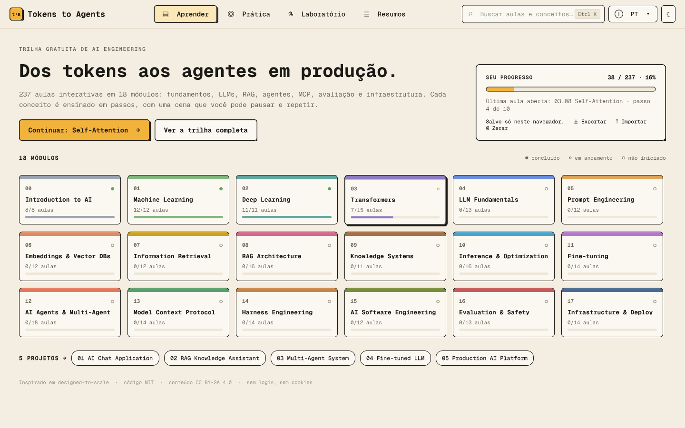
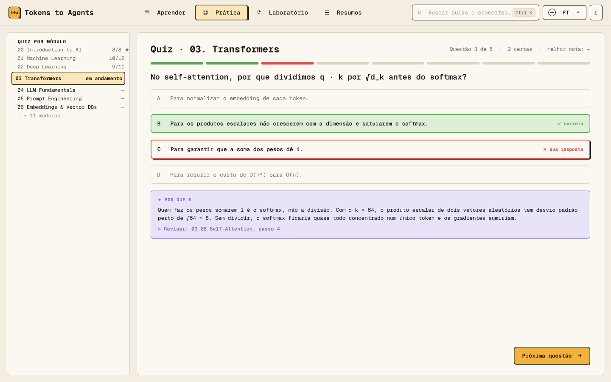
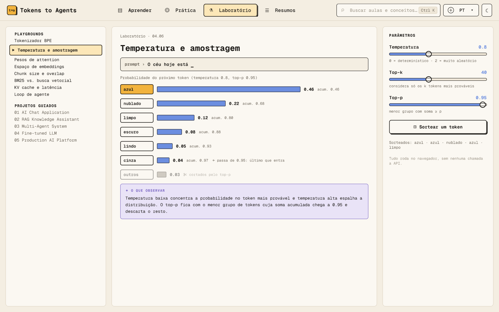
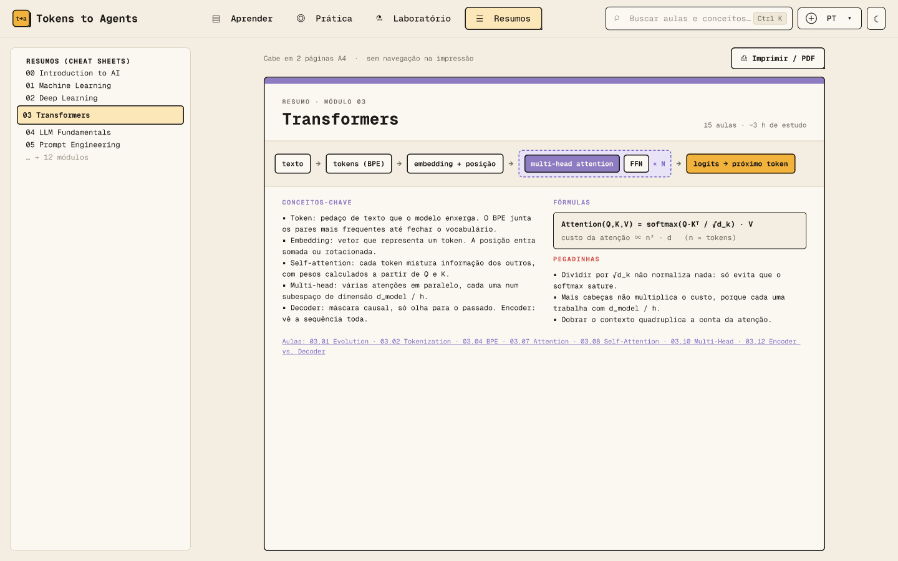

<div align="center">

# Tokens to Agents

**A free, interactive AI Engineering track — from tokens to agents in production.**

Every concept is taught in short steps, each paired with a scene you can pause, replay and explore.
Built with React, TypeScript, Vite and Tailwind CSS. Runs entirely in the browser: no login, no cookies, and the lessons and playgrounds make no API calls.


</div>

---

## Table of contents

- [Highlights](#highlights)
- [Screens](#screens)
- [Tech stack](#tech-stack)
- [Getting started](#getting-started)
- [Available scripts](#available-scripts)
- [Project structure](#project-structure)
- [Design system](#design-system)
- [How lessons work](#how-lessons-work)
- [Keyboard shortcuts](#keyboard-shortcuts)
- [Testing](#testing)
- [Project status](#project-status)
- [Contributing](#contributing)
- [License](#license)

## Highlights

- **18 modules and 237 lessons** covering the full AI Engineering roadmap: ML and deep learning fundamentals, Transformers, LLMs, prompt engineering, embeddings and vector databases, retrieval, RAG, knowledge systems, inference, fine-tuning, agents, MCP, harness engineering, evaluation and infrastructure.
- **Step-by-step lessons** with a scene, a narration panel, a stepper, a "you will learn" checklist and, at the end, a real-world example, trade-offs, a knowledge check, related lessons and references.
- **Scene engine**: every step declares its scene as data, built from nine reusable pieces (token stream, matrix, vector space, graph, pipeline, agent loop, client-server, chart and metrics panel) or a custom scene such as the isometric RAG flow. Everything is plain SVG.
- **Practice**: one quiz per module, one question at a time, with instant feedback, the explanation and a link back to the lesson that teaches the topic. The best score is kept.
- **Lab**: eight playgrounds (BPE tokenizer, temperature and sampling, attention weights, embedding space, chunk size and overlap, BM25 vs. vector search, KV cache and latency, agent loop) that recompute the scene as you move the controls, plus five guided projects.
- **Summaries**: one printable cheat sheet per module (diagram, key concepts, formulas, pitfalls and the lessons to revisit) that fits in two A4 pages.
- **21 interface languages**, including Arabic and Hebrew in right-to-left, with the script font loaded on demand.
- **Local progress**: saved only in your browser, with export, import and reset.
- **Light and dark themes** driven by the same design tokens.
- **Accessible by default**: keyboard navigation, an accessible description for every scene, reduced-motion support and WCAG AA contrast on the theme tokens.

## Screens

| Home | Practice |
| --- | --- |
|  |  |

| Lab | Summaries |
| --- | --- |
|  |  |

## Tech stack

| Area | Choice |
| --- | --- |
| UI | [React 19](https://react.dev) + [TypeScript](https://www.typescriptlang.org) |
| Build | [Vite](https://vite.dev) |
| Styling | [Tailwind CSS v4](https://tailwindcss.com) with CSS custom properties as design tokens |
| Icons | [Lucide](https://lucide.dev) |
| Typography | [Geist Mono](https://vercel.com/font) and the Noto Sans families for non-Latin scripts, via Fontsource |
| Diagrams | Native SVG, no charting library |
| Analytics | [Vercel Web Analytics](https://vercel.com/docs/analytics), cookieless, production build only, page path only |
| Tests | [Vitest](https://vitest.dev) + [Testing Library](https://testing-library.com) + jsdom |
| Lint | [oxlint](https://oxc.rs) |

## Getting started

**Requirements:** Node.js 20.19+ (or 22.12+) and npm.

```bash
git clone https://github.com/MauricioAraujo1/tokens-to-agents.git
cd tokens-to-agents
npm install
npm run dev
```

Open the URL printed by Vite (by default <http://localhost:5173>).

## Available scripts

| Command | Description |
| --- | --- |
| `npm run dev` | Starts the development server with hot reload. |
| `npm run build` | Type-checks the project and builds the production bundle into `dist/`. |
| `npm run preview` | Serves the production build locally. |
| `npm test` | Runs the full test suite once. |
| `npm run test:watch` | Runs the tests in watch mode. |
| `npm run lint` | Lints the codebase with oxlint. |
| `npm run validate:content` | Release check: every lesson, quiz, summary and project must be written and valid, internal links must resolve and external references must respond. It needs network access. |

## Project structure

```text
src/
├── app/              # App shell: header, sidebar and the page for the current route
├── pages/            # One page per route: Home, Lesson, Practice, Lab, Summaries, Not found
├── content/          # Course content as typed data
│   ├── catalog.ts    #   The 18 modules and 237 lessons (id, number, title, duration, level) and the 5 projects
│   ├── registry.ts   #   Lazy loaders for lessons, quizzes, summaries and projects
│   ├── lessons/NN/   #   One file per lesson (LessonContent), one chunk per module
│   ├── quizzes/      #   One quiz per module
│   ├── summaries/    #   One cheat sheet per module
│   ├── playgrounds/  #   Texts and data of each playground
│   ├── scenes/       #   Texts of the custom scenes
│   ├── glossary.ts   #   Terms linked from the lesson text
│   └── validate.ts   #   Content rules shared by the tests and the release check
├── scene/            # Scene engine: <Scene>, the nine pieces, custom scenes, accessible descriptions
├── lab/              # Playground registry, pure playground logic and the playground components
├── i18n/             # Locales, message files for the 21 languages, provider, plurals, script fonts
├── components/       # UI by area: course, diagrams, home, lab, layout, lesson, practice, summaries, ui
├── hooks/            # Route, lesson navigation, progress, shortcuts, swipe, theme, panel resize
├── lib/              # Pure logic: router, course, lesson, progress (schema, store, import/export), search, storage, analytics
├── styles/           # Design tokens, global styles, motion and print styles
└── types/            # Content and app types
scripts/              # Release content validation (`npm run validate:content`)
docs/                 # Curriculum roadmap, product brief and screenshots
```

Pure logic lives in `src/lib`, `src/lab` and `src/scene` as tested functions; components render state and forward events.

## Design system

The tokens live in [`src/styles/tokens.css`](src/styles/tokens.css) and are exposed to Tailwind through `@theme` in [`src/styles/globals.css`](src/styles/globals.css):

- **Surfaces:** `paper`, `grid`, `surface`, `sunken`
- **Ink:** `ink`, `muted`, `subtle`
- **Lines:** `line`, `line-strong`
- **Accent and states:** `brand`, `brand-soft`, `on-brand`, `success`, `info`, `danger` (and their `-soft` variants)
- **Diagram colors:** `diagram-green`, `diagram-blue`, `diagram-purple`, `diagram-orange`, `diagram-red`, `diagram-yellow`
- **Module colors:** `--module-00` … `--module-17`
- **Hard shadows:** `shadow-press-sm`, `shadow-press`, `shadow-press-lg`
- **Motion:** `animate-fade-in`, `animate-step-in`, `animate-rise`, `animate-pop-in`, `animate-zone-in`, all turned off under `prefers-reduced-motion`

Rules of thumb: Geist Mono everywhere, 4px spacing scale, 1–1.5px borders in `line-strong`, hard offset shadows only on clickable or highlighted elements, and a 24px grid behind every scene.

## How lessons work

**Catalog.** [`src/content/catalog.ts`](src/content/catalog.ts) lists the 18 modules and their lessons with the id (`"03-08"`), the roadmap number (`"03.08"`), the title, the duration and the level. The home, the sidebar, the search and the routes (`/learn/03-08?step=4`) read only the catalog, so a lesson appears in the track before its content is written.

**Content.** A lesson is a typed `LessonContent` object ([`src/types/content.ts`](src/types/content.ts)) in `src/content/lessons/NN/`: a subtitle, objectives, about ten steps, a real-world example, optional code, trade-offs, a knowledge check, related lessons and references. Each step has a short title for the stepper, a title, a tag, the body paragraphs (glossary terms marked as `[[term|glossaryId]]`), an optional key idea, its scene and an optional accessible description:

```ts
{
  id: "text-to-numbers",
  shortTitle: "Por quê",
  title: "Uma rede neural só opera sobre números",
  tag: "context",
  body: ["Um modelo de linguagem é uma pilha de multiplicações de matrizes…"],
  keyIdea: "O modelo nunca vê o seu texto. Ele vê a sequência de ids que o tokenizador produziu.",
  scene: {
    kind: "pieces",
    layout: "column",
    pieces: [
      { id: "tokens", piece: "token-stream", tokens: sentenceTokens },
      { id: "ids", piece: "token-stream", tokens: sentenceIds.map(String), color: "info" },
    ],
  },
}
```

**Registry.** [`src/content/registry.ts`](src/content/registry.ts) loads lessons, quizzes, summaries and projects on demand with `import.meta.glob`. A lesson listed in the catalog without a content file opens a "lesson in preparation" message instead of failing.

**Scenes.** A scene is either a set of pieces with a layout (`single`, `row`, `column`, `grid` or `overlay`) or a custom scene by id (`{ kind: "custom", id: "rag-flow" }`). Pieces keep their `id` across steps, so `<Scene>` animates what changed between two steps. Scene colors accept only theme tokens, and `describeScene` builds the accessible description when the step does not provide one.

To add a lesson:

1. Make sure the lesson is in `src/content/catalog.ts`.
2. Create `src/content/lessons/NN/NN-MM-slug.ts` exporting a `LessonContent` with the catalog id; the module's `index.ts` picks it up.
3. Build each step's scene from the pieces in `src/scene/pieces`, or register a custom scene in `src/scene/custom`.
4. Run `npm test` and `npm run build`: the content tests validate steps, glossary terms, quizzes, summaries, related lessons and references against the catalog, and the compiler checks every scene against the piece types.

Quizzes live in `src/content/quizzes/NN.ts`, cheat sheets in `src/content/summaries/NN.ts` and the playgrounds in `src/lab/registry.ts`, with their texts in `src/content/playgrounds/`.

## Keyboard shortcuts

| Shortcut | Action |
| --- | --- |
| `Ctrl` / `⌘` + `K` | Open search |
| `←` / `→` | Previous / next step (mirrored in right-to-left languages: `→` goes back and `←` goes forward) |
| `Space` | Pause or resume the scene |
| `R` | Replay the current step |
| `↑` / `↓` + `Enter` | Navigate and open search results |
| Arrows, `Home`, `End` | Move through the language menu |
| `Esc` | Close search or the language menu |

On touch screens, swiping left or right also changes the step.

## Testing

```bash
npm test
```

The suite covers the pure logic (router, course, progress schema, store and import/export, search, storage, analytics filter, the playground algorithms and the scene layouts), every content file in `src/content` against the catalog and the content rules, the i18n message files (no empty string and the same placeholders as pt-BR; a missing key breaks the type check), the theme tokens (WCAG AA contrast and the reduced-motion rule) and the main user flows with Testing Library: home and "continue", lesson navigation and shortcuts, search, theme and language switching, progress export/import/reset, quizzes, playgrounds and cheat sheets, including the print layout.

Before a release, `npm run validate:content` checks that the whole track is written and that every external reference responds.

## Project status

The platform, the design system and the main flows are in place, and content is being written module by module:

- **Interface:** 21 languages. Lesson content is written in Portuguese; in other languages a notice says so.
- **Pilot:** module **03 Transformers**, with its 15 lessons, its quiz and its cheat sheet. Lesson **08.02 RAG Architecture** uses the custom RAG scene. The other lessons open a "lesson in preparation" message, and the other quizzes and cheat sheets are listed as "in production".
- **Lab:** the 8 playgrounds are ready; the 5 guided projects are listed as "in production".

The full curriculum is described in [`docs/ai-engineering-roadmap.md`](docs/ai-engineering-roadmap.md).

## Contributing

Contributions are welcome — new lessons and scenes, quizzes, cheat sheets, playgrounds, translations and fixes.

1. Create a branch from `master`.
2. Follow the existing patterns: typed content in `src/content`, scenes built from the pieces in `src/scene`, interface text through `t()` with the key in every file of `src/i18n/messages`, pure logic in `src/lib` and `src/lab`, and design tokens instead of raw colors.
3. Add or update tests, then run `npm run lint`, `npm test` and `npm run build`.
4. Open a pull request describing the change and, for visual work, attach a screenshot.

## License

Tokens to Agents is open source under two licenses:

- **Code** — [MIT License](LICENSE).
- **Educational content** (lessons, quizzes, summaries, projects, playground texts and the glossary in `src/content/`, and the curriculum in `docs/`) — [Creative Commons Attribution-ShareAlike 4.0 International](LICENSE-CONTENT) (CC BY-SA 4.0).

The bundled fonts keep their own license, the SIL Open Font License; see [LICENSE-FONTS](LICENSE-FONTS).

You are free to reuse, adapt and translate the content as long as you give appropriate credit and share your adaptations under the same license.
