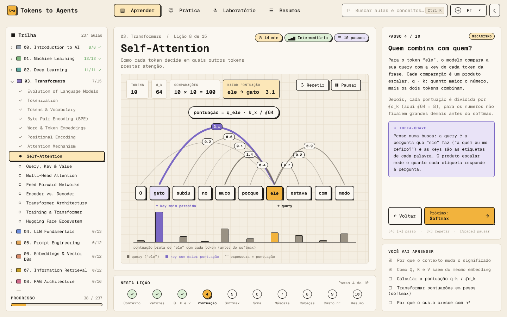

<div align="center">

# Tokens to Agents

**A free, interactive AI Engineering track — from tokens to agents in production.**

Every concept is taught in short steps, each paired with a scene you can pause, replay and explore.
Built with React, TypeScript, Vite and Tailwind CSS. Runs entirely in the browser: no login, no cookies, no API calls.



</div>

---

## Table of contents

- [Highlights](#highlights)
- [Screens](#screens)
- [Tech stack](#tech-stack)
- [Getting started](#getting-started)
- [Available scripts](#available-scripts)
- [Project structure](#project-structure)
- [Design system](#design-system)
- [How lessons work](#how-lessons-work)
- [Keyboard shortcuts](#keyboard-shortcuts)
- [Testing](#testing)
- [Project status](#project-status)
- [Contributing](#contributing)
- [License](#license)

## Highlights

- **18 modules** covering the full AI Engineering roadmap: ML and deep learning fundamentals, Transformers, LLMs, prompt engineering, embeddings and vector databases, retrieval, RAG, knowledge systems, inference, fine-tuning, agents, MCP, harness engineering, evaluation and infrastructure.
- **Step-by-step lessons** with an animated scene, a narration panel, a stepper and learning objectives that tick off as you progress.
- **Interactive diagrams** drawn in plain SVG: an isometric RAG pipeline and a self-attention token stream with weighted arcs and scores.
- **Practice**: per-module quizzes with instant feedback, explanations and a link back to the exact lesson step to review.
- **Lab**: a temperature / top-k / top-p sampling playground that recomputes the next-token distribution live and samples tokens in the browser.
- **Summaries**: printable cheat sheets per module (pipeline, key concepts, formulas and common pitfalls).
- **Local progress**: saved only in your browser, with export, import and reset.
- **Light and dark themes** driven by the same design tokens as the FigCraft design file.
- **Accessible by default**: keyboard navigation, ARIA roles on every interactive diagram, reduced-motion support.

## Screens

| Home | Practice |
| --- | --- |
|  |  |

| Lab | Summaries |
| --- | --- |
|  |  |

More references live in [`design/previews`](design/previews), including the dark theme, the search dialog, the language selector and the RAG diagram blocks.

## Tech stack

| Area | Choice |
| --- | --- |
| UI | [React 19](https://react.dev) + [TypeScript](https://www.typescriptlang.org) |
| Build | [Vite](https://vite.dev) |
| Styling | [Tailwind CSS v4](https://tailwindcss.com) with CSS custom properties as design tokens |
| Icons | [Lucide](https://lucide.dev) |
| Typography | [Geist Mono](https://vercel.com/font) via Fontsource |
| Diagrams | Native SVG, no charting library |
| Tests | [Vitest](https://vitest.dev) + [Testing Library](https://testing-library.com) + jsdom |
| Lint | [oxlint](https://oxc.rs) |

## Getting started

**Requirements:** Node.js 20.19+ (or 22.12+) and npm.

```bash
git clone https://github.com/MauricioAraujo1/tokens-to-agents.git
cd tokens-to-agents
npm install
npm run dev
```

Open the URL printed by Vite (by default <http://localhost:5173>).

## Available scripts

| Command | Description |
| --- | --- |
| `npm run dev` | Starts the development server with hot reload. |
| `npm run build` | Type-checks the project and builds the production bundle into `dist/`. |
| `npm run preview` | Serves the production build locally. |
| `npm test` | Runs the full test suite once. |
| `npm run test:watch` | Runs the tests in watch mode. |
| `npm run lint` | Lints the codebase with oxlint. |

## Project structure

```text
src/
├── app/              # App shell: routing between sections and global state wiring
├── components/
│   ├── course/       # Course tree (modules, lessons) and progress bar
│   ├── diagrams/     # SVG scenes: RAG pipeline, self-attention, layout helpers
│   ├── home/         # Home screen and module cards
│   ├── lab/          # Playgrounds (sampling)
│   ├── layout/       # Header, sidebar, panels, search, language menu
│   ├── lesson/       # Lesson header, scene, stepper and step navigation
│   ├── practice/     # Quizzes
│   ├── summaries/    # Cheat sheets
│   └── ui/           # Design system primitives (Button, Badge, Tag, Callout, Kbd)
├── data/             # Typed course content: modules, lessons, quizzes, summaries, labs
├── hooks/            # Navigation, progress, shortcuts, theme, panel resize
├── lib/              # Pure domain logic (course, lesson, progress, quiz, sampling, search)
├── styles/           # Design tokens and global styles
└── types/            # Domain types
design/               # FigCraft design file, exported tokens and previews
docs/                 # Curriculum roadmap and product brief
```

Domain logic lives in `src/lib` as pure, fully tested functions; components only render state and forward events.

## Design system

The single source of truth for the visual language is the FigCraft file
[`design/tokens-to-agents.figcraft`](design/tokens-to-agents.figcraft):

| Page | Content |
| --- | --- |
| `01 · Design System` | Theme tokens (light and dark), module colors, typography and components |
| `02 · Aula` | Lesson screen in light, dark, RTL, mobile, search and language selector states |
| `03 · Home, Prática, Laboratório, Resumos` | The remaining application screens |
| `04 · Blocos do diagrama` | Every RAG diagram block (user, application, embedding, vector database, retrieval, context, LLM, answer, fallback) in default and active states, plus pills, edges and drawing rules |

The tokens are mirrored in [`src/styles/globals.css`](src/styles/globals.css) and exposed to Tailwind through `@theme`:

- **Surfaces:** `paper`, `grid`, `surface`, `sunken`
- **Ink:** `ink`, `muted`, `subtle`
- **Lines:** `line`, `line-strong`
- **Accent and states:** `brand`, `brand-soft`, `on-brand`, `success`, `info`, `danger` (and their `-soft` variants)
- **Module colors:** `--module-00` … `--module-17`
- **Hard shadows:** `shadow-press-sm`, `shadow-press`, `shadow-press-lg`

Rules of thumb: Geist Mono everywhere, 4px spacing scale, 1–1.5px borders in `line-strong`, hard offset shadows only on clickable or highlighted elements, and a 24px grid behind every scene.

## How lessons work

A lesson is plain typed data (`src/types/course.ts`). Each step has a title, a description, an optional key idea and a pointer into the scene:

```ts
{
  id: "score",
  title: "Quem combina com quem?",
  shortTitle: "Pontuação",
  description: "Para o token “ele”, o modelo compara a sua query com a key de cada token…",
  tip: "Pense numa busca: a query é a pergunta que “ele” faz…",
  attentionView: "scores",
  badge: "mechanism",
}
```

To add a lesson:

1. Create the lesson in `src/data/lessons/` (or use `createGenericLesson` for a lesson without a scene yet).
2. Register it in its module in `src/data/course.ts`.
3. Optionally set `diagram` (`"rag-flow"` or `"attention"`), `stats` and `objectives`.
4. Run `npm test`: the content tests validate ids, step references, quizzes and summaries.

Quizzes live in `src/data/quizzes.ts`, cheat sheets in `src/data/summaries.ts` and playgrounds in `src/data/labs.ts`.

## Keyboard shortcuts

| Shortcut | Action |
| --- | --- |
| `Ctrl` / `⌘` + `K` | Open search |
| `←` / `→` | Previous / next step |
| `Space` | Pause or resume the scene |
| `R` | Replay the lesson from the first step |
| `↑` / `↓` + `Enter` | Navigate and open search results |
| `Esc` | Close search or the language menu |

## Testing

```bash
npm test
```

The suite covers the domain logic (course, progress persistence, quiz scoring, sampling, attention layout), the content catalog and the main user flows end to end with Testing Library: continuing a lesson, step navigation, search, theme switching, progress import/reset, quizzes, the sampling lab and the cheat sheets.

## Project status

The platform shell, the design system and the main flows are in place. Content is being authored module by module:

- Full interactive scenes: **08.03 How RAG works** and **03.02 Self-Attention**. Other lessons use a generic three-step structure until their scenes are ready.
- Quizzes and cheat sheets: modules **03 Transformers** and **08 RAG**.
- Lab: the **sampling** playground; the other playgrounds and the five guided projects are listed as coming soon.
- Interface language: Portuguese. The language menu already lists the planned languages (including RTL ones) as coming soon.

The full curriculum is described in [`docs/ai-engineering-roadmap.md`](docs/ai-engineering-roadmap.md).

## Contributing

Contributions are welcome — new lessons and scenes, quizzes, cheat sheets, playgrounds and fixes.

1. Create a branch from `master`.
2. Follow the existing patterns: typed data in `src/data`, pure logic in `src/lib`, presentational components in `src/components`, and design tokens instead of raw colors.
3. Add or update tests, then run `npm run lint`, `npm test` and `npm run build`.
4. Open a pull request describing the change and, for visual work, attach a screenshot.

## License

Tokens to Agents is open source under two licenses:

- **Code** — [MIT License](LICENSE).
- **Educational content** (lessons, quizzes, summaries and labs in `src/data/`, and the curriculum in `docs/`) — [Creative Commons Attribution-ShareAlike 4.0 International](LICENSE-CONTENT) (CC BY-SA 4.0).

You are free to reuse, adapt and translate the content as long as you give appropriate credit and share your adaptations under the same license.
